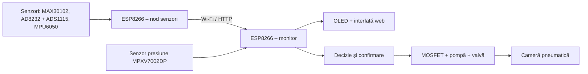
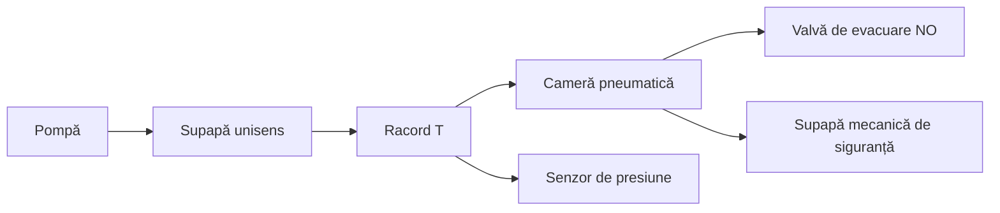
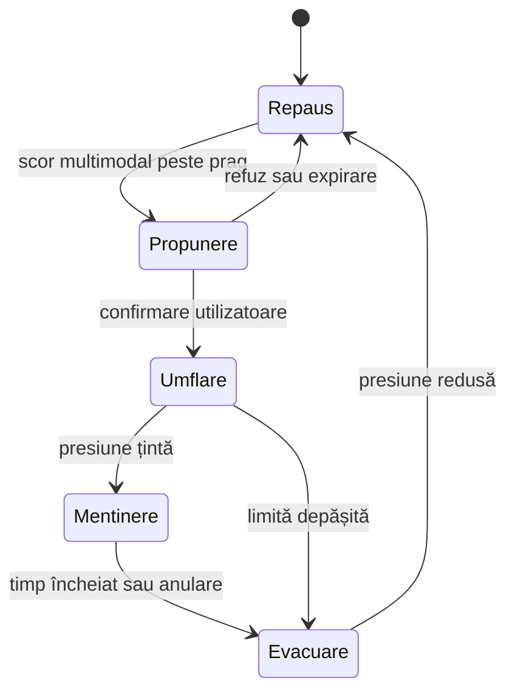

# Thoracare – vestă inteligentă cu *Hugging Shield*

> **Prototip educațional de cercetare și inginerie aplicată.** Sistemul nu este dispozitiv medical, nu stabilește diagnostice și nu înlocuiește consultul de specialitate.

## Datele proiectului

## Echipa Thoracare

### Guzu Isabella-Elena

Responsabilă de documentarea științifică, dezvoltarea conceptului Thoracare, alegerea și analiza senzorilor, proiectarea sistemului pneumatic Hugging Shield și realizarea interfeței web.

### Stoian Ștefania

Responsabilă de realizarea circuitului electronic, programarea plăcilor ESP8266, comunicația Wi-Fi, integrarea senzorilor și testarea funcționării prototipului.

### Activități realizate împreună

- proiectarea arhitecturii generale;
- integrarea componentelor în vestă;
- testarea senzorilor și interpretarea datelor;
- evaluarea siguranței sistemului pneumatic;
- realizarea documentației și prezentarea proiectului.

### Mentor

**Rădulescu Ramona** – coordonarea metodologiei de cercetare, verificarea etapelor experimentale și sprijin pentru prezentarea științifică.

### Instituție

**Liceul Tehnologic „Lazăr Edeleanu” Năvodari**  
Clubul de Robotică Năvodari
---

## 1. Rezumat

Thoracare este un prototip de vestă inteligentă care achiziționează sincron semnale fiziologice și de mișcare și poate comanda, numai după confirmarea utilizatoarei, un mecanism pneumatic de compresie blândă denumit *Hugging Shield*. Arhitectura experimentală utilizează două plăci ESP8266: un nod achiziționează datele de la senzori, iar al doilea nod gestionează afișajul OLED, pagina web locală și recepția datelor prin Wi-Fi.

Sistemul urmărește tendințe individuale ale pulsului și semnalului fotopletismografic, semnalul ECG brut, mișcarea corpului și presiunea pneumatică. Datele nu sunt interpretate ca valori medicale absolute. Ele sunt comparate cu un profil personal de repaus, construit prin măsurători repetate. Dacă mai multe semnale se modifică simultan, algoritmul poate propune activarea compresiei. Pompa pornește numai după acordul utilizatoarei, iar presiunea este măsurată continuu și limitată prin mecanisme software și hardware independente.

Întrebarea principală de cercetare este dacă fuziunea mai multor senzori, raportarea la profilul personal și confirmarea utilizatoarei pot reduce activările false față de un sistem bazat pe un singur prag. A doua direcție investighează dacă presiunea unei camere pneumatice poate fi controlată stabil, repetabil și sigur într-un prototip purtabil.

**Cuvinte-cheie:** senzori purtabili, fuziune multimodală, ESP8266, fotopletismografie, ECG, control pneumatic, compresie blândă, siguranță funcțională.

---

## 2. Context și fundamentare

Stresul produce schimbări care pot apărea simultan în ritmul cardiac, respirație, mișcare și alte semnale fiziologice. Totuși, niciunul dintre aceste semnale nu demonstrează singur existența unei stări de stres: pulsul poate crește și în urma mișcării, temperaturii ambientale sau efortului. Din acest motiv, Thoracare utilizează o abordare multimodală și personalizată, nu un prag universal.

Literatura de specialitate oferă două direcții relevante. Prima este recunoașterea stărilor afective cu ajutorul senzorilor purtabili. Setul WESAD a demonstrat utilitatea combinării semnalelor fiziologice și de mișcare într-un protocol experimental controlat. PPG-DaLiA arată, în mod particular, că mișcarea influențează măsurarea pulsului prin PPG și justifică utilizarea simultană a unui accelerometru. A doua direcție este reprezentată de interfețele haptice pneumatice, precum Force Jacket, care demonstrează că camerele de aer pot aplica forțe controlabile pe suprafețe extinse ale trunchiului.

Thoracare nu reproduce aceste sisteme. Contribuția sa constă în integrarea, într-un prototip educațional accesibil, a patru principii: profil personal, decizie multimodală, confirmare umană înainte de acționare și control pneumatic în buclă închisă.

---

## 3. Problema de cercetare

### 3.1 Întrebări

1. Poate fuziunea semnalelor PPG, ECG și IMU să reducă numărul activărilor false față de utilizarea exclusivă a pulsului?
2. Poate o linie de bază individuală să ofere o interpretare mai robustă decât un prag identic pentru toate persoanele?
3. Poate o cameră pneumatică să atingă și să mențină repetabil o presiune țintă de test, fără depășirea limitei de siguranță stabilite experimental?
4. Poate utilizatoarea să păstreze permanent controlul prin confirmare, anulare și evacuare imediată?

### 3.2 Ipoteze

- **H1:** o regulă bazată pe minimum două modalități va produce mai puține activări false decât o regulă bazată numai pe puls.
- **H2:** normalizarea față de profilul personal va reduce variațiile dintre sesiuni.
- **H3:** feedbackul oferit de senzorul de presiune va reduce abaterea față de presiunea țintă comparativ cu acționarea pompei pentru un timp fix.
- **H4:** confirmarea manuală și evacuarea independentă vor crește controlul perceput al utilizatoarei asupra sistemului.

---

## 4. Obiective

### Obiectiv general

Realizarea și evaluarea unui prototip purtabil care combină achiziția multimodală de semnale cu o compresie pneumatică blândă, controlată și anulabilă.

### Obiective specifice

1. Integrarea senzorilor cu două noduri ESP8266.
2. Transmiterea datelor printr-o rețea Wi-Fi locală.
3. Afișarea stării pe OLED și într-o interfață web.
4. Înregistrarea datelor într-un format CSV reproductibil.
5. Construirea unei linii de bază personale.
6. Compararea regulii unimodale cu o regulă multimodală.
7. Construirea unei singure camere pneumatice funcționale pentru prima validare.
8. Introducerea limitării presiunii, opririi manuale și evacuării automate la pierderea alimentării.

---

## 5. Arhitectura sistemului



### 5.1 Nodul de senzori

Nodul de senzori achiziționează semnale, verifică prezența dispozitivelor I²C, aplică filtrarea inițială și transmite periodic un pachet de date. Unitatea nu comandă direct pompa în versiunea de bază, pentru a separa achiziția de controlul actuatorului.

### 5.2 Nodul de monitorizare

Al doilea ESP8266 primește datele, actualizează OLED-ul, furnizează pagina web locală și urmărește timpul de la ultimul pachet. Dacă datele nu mai sosesc într-un interval stabilit, sistemul trece în starea sigură: pompa oprită și evacuare permisă.

### 5.3 Comunicația

Ambele plăci se conectează la același router, dar primesc adrese IP diferite. Nodul de senzori trimite cereri HTTP către adresa nodului monitor. Pentru stabilitate, adresa monitorului trebuie rezervată în router sau configurată static în aceeași subrețea.

---

## 6. Componente și roluri

| Componentă | Rol în prototip | Interfață / observație |
|---|---|---|
| 2 × ESP8266 | achiziție, comunicație, afișare și control | Wi-Fi, GPIO, I²C |
| MAX30102 / GY-MAX3010x | semnal PPG, estimare experimentală puls și SpO₂ | I²C; necesită contact stabil și filtrarea artefactelor |
| AD8232 | condiționarea semnalului ECG | ieșire analogică; electrozii trebuie verificați separat |
| ADS1115 | conversie analog-digital de rezoluție mai mare pentru ECG și presiune | I²C, adresă uzuală 0x48 |
| MPU6050 | accelerație, rotație și identificarea mișcării | I²C; temperatura internă nu este temperatura corpului |
| OLED 128 × 64 | afișarea IP-ului, stării și valorilor principale | I²C, adresă uzuală 0x3C |
| MPXV7002DP | feedback de presiune diferențială pentru circuitul pneumatic | analogic; necesită calibrare și verificarea domeniului |
| modul microSD + card | stocare locală CSV | SPI; opțional în etapa inițială |
| pompă cu diafragmă 6–12 V | umflarea camerei pneumatice | alimentare separată, nu din ESP8266 |
| placă MOSFET | comutarea electrică a pompei | comandă GPIO, masă comună |
| valvă NC | blochează/controlează umplerea când nu este comandată | alegerea tensiunii trebuie să corespundă sursei |
| valvă NO | evacuare implicită la pierderea alimentării | contribuie la starea sigură |
| supapă mecanică | limită independentă de software | obligatorie înaintea testelor purtabile |
| tuburi, racord T și reductor | distribuția aerului | dimensiunea se verifică după diametrul exterior al racordului |
| cameră pneumatică | aplicarea compresiei | prima versiune folosește o singură cameră |
| 2 × acumulator Li-ion 3,7 V | alimentarea pompei, dacă sunt configurate corect | necesită suport, BMS 2S și încărcător 2S adecvat |

### Componente care nu trebuie confundate

- TP4056 este destinat unei singure celule Li-ion (1S) și nu încarcă în siguranță două celule puse în serie.
- Un BMS protejează acumulatorii, dar nu înlocuiește încărcătorul corect.
- SX1308 ridică tensiunea, dar nu este necesar dacă sursa oferă deja tensiunea adecvată pompei; reglajul trebuie măsurat înainte de conectarea sarcinii.
- BME280 măsoară condițiile ambientale și nu înlocuiește un senzor de temperatură corporală.

---

## 7. Conectarea electronică de bază

> Conectările se realizează fără baterii și fără cablul USB introdus. Se verifică polaritatea și tensiunea cu multimetrul înainte de alimentare.

### 7.1 Magistrala I²C a nodului de senzori

În configurația experimentală utilizată:

- `D6` → SDA;
- `D5` → SCL;
- `3V3` → alimentarea modulelor compatibile cu 3,3 V;
- `GND` → masă comună.

MAX30102, ADS1115 și MPU6050 pot utiliza aceeași magistrală I²C dacă au adrese diferite și conexiunile sunt scurte. Înainte de programul complet se rulează un scanner I²C.

### 7.2 OLED

Pe nodul monitor:

- `D2` → SDA;
- `D1` → SCL;
- `3V3` → VCC;
- `GND` → GND.

### 7.3 AD8232 și ADS1115

- `AD8232 OUT` → `ADS1115 A0`;
- alimentarea AD8232 → tensiunea acceptată de modulul concret;
- `GND AD8232` → masă comună;
- `LO+` și `LO−` → doi pini digitali disponibili, dacă sunt utilizați pentru detectarea electrozilor desprinse.

### 7.4 MOSFET și pompă

- baterie `+` → `VIN/V+` al modulului MOSFET;
- baterie `−` → `GND/V−`;
- pompă `+` → `OUT+`;
- pompă `−` → `OUT−`;
- `GND` MOSFET → `GND` ESP8266;
- `IN/SIG` MOSFET → pin digital liber, numai după confirmarea compatibilității cu logica de 3,3 V.

Pompa nu se alimentează din pinul ESP8266. Pentru sarcinile inductive se utilizează protecția flyback integrată sau o diodă adecvată montată conform schemei modulului.

### 7.5 Circuit pneumatic minim



Pentru pompa menționată, racordurile declarate sunt aproximativ 6 mm la intrare și 9 mm la ieșire. Dimensiunea finală se verifică prin măsurare. Pentru prototip sunt suficienți aproximativ 2 m de tub, dar traseul funcțional trebuie păstrat cât mai scurt. Un reductor 9 → 6 mm permite standardizarea restului circuitului la tub compatibil cu racordurile disponibile.

---

## 8. Software

### 8.1 Firmware-ul nodului de senzori

Funcții principale:

1. inițializarea magistralei I²C;
2. detectarea MAX30102, ADS1115 și MPU6050;
3. achiziția semnalelor;
4. verificarea calității minime a datelor;
5. formarea pachetului;
6. trimiterea prin HTTP către nodul monitor;
7. reconectarea automată la Wi-Fi.

Exemplu conceptual de pachet:

```json
{
  "timestamp_ms": 125000,
  "pulse_bpm": 78,
  "spo2_percent": 97,
  "ecg_raw": 14321,
  "accel_magnitude": 9.91,
  "motion_flag": 0,
  "pressure_kpa": 0.00,
  "signal_quality": 1
}
```

Valorile din exemplu ilustrează formatul și nu reprezintă rezultate experimentale ale proiectului.

### 8.2 Firmware-ul nodului monitor

Nodul monitor expune:

- `/` – pagina web;
- `/update` – recepția datelor;
- `/data` – furnizarea valorilor în format JSON.

Pagina web afișează pulsul, SpO₂, ECG brut, mișcarea, presiunea, starea conexiunii, IP-ul și timpul de funcționare. Datele se actualizează fără reîncărcarea completă a paginii.

### 8.3 Stări de control recomandate



Orice eroare de senzor, pierdere de comunicație sau apăsare a butonului de urgență trebuie să ducă la `POMPĂ = OPRIT` și `EVACUARE = DESCHISĂ`.

---

## 9. Colectarea și stocarea datelor

Datele se salvează în CSV, câte un rând pentru fiecare eșantion sau fereastră calculată:

```csv
timestamp_ms,session_id,condition,ppg_ir,ppg_red,pulse_bpm,spo2_percent,ecg_raw,ax,ay,az,gx,gy,gz,pressure_kpa,user_confirmation,label,signal_quality
```

### Reguli de gestionare

- se folosesc identificatori anonimi de sesiune;
- parolele Wi-Fi nu se salvează în repository;
- datele personale nu se publică;
- fișierele brute se păstrează separat de datele procesate;
- fiecare sesiune conține metadate: poziția senzorilor, durata, activitatea, versiunea firmware-ului și observațiile privind calitatea semnalului;
- orice test purtabil se realizează numai cu acord informat și supraveghere adecvată.

---

## 10. Prelucrarea datelor și componenta AI

Prima versiune nu are nevoie de o rețea neuronală. Pentru un proiect științific verificabil, este preferabilă o progresie în trei etape.

### Etapa A – reguli explicabile

1. eliminarea valorilor invalide;
2. filtrarea semnalelor;
3. împărțirea în ferestre temporale;
4. calcularea caracteristicilor;
5. compararea cu linia de bază personală;
6. activarea propunerii numai când minimum două categorii de semnale indică simultan o abatere.

Caracteristici posibile: abaterea pulsului față de repaus, variabilitatea pe fereastră, energia mișcării, variația ECG și calitatea contactului.

### Etapa B – model statistic

După colectarea unui set suficient de date etichetate se poate testa regresia logistică sau un arbore de decizie. Aceste modele sunt potrivite pentru început deoarece permit explicarea contribuției fiecărei variabile.

### Etapa C – comparație cu seturi publice

WESAD poate fi utilizat pentru înțelegerea metodologiei de detecție multimodală, iar PPG-DaLiA pentru studierea artefactelor produse de mișcare. Aceste seturi nu trebuie amestecate direct cu datele Thoracare fără armonizarea senzorilor, frecvențelor de eșantionare și etichetelor. Ele servesc ca referință și pentru preantrenare experimentală, nu ca dovadă a performanței vestei.

### Evaluare

Se raportează matricea de confuzie, precizia, sensibilitatea, specificitatea, scorul F1 și numărul activărilor false pe sesiune. Separarea seturilor trebuie făcută pe sesiuni sau pe participanți, nu prin împărțirea aleatorie a ferestrelor apropiate, pentru a evita scurgerea de informație.

---

## 11. Metodologie experimentală

### Faza 1 – validarea separată

- scanner I²C și confirmarea adreselor;
- test MAX30102 cu degetul nemișcat, apoi cu mișcare controlată;
- test AD8232 + ADS1115 cu simulator sau cu electrozi utilizați prudent, fără acționarea pneumatică simultană;
- test MPU6050 în repaus și în mișcare;
- calibrarea senzorului de presiune față de un instrument de referință;
- testarea pompei și a valvei numai pe masă.

### Faza 2 – comunicație și sincronizare

- măsurarea pierderilor de pachete;
- verificarea timpului dintre eșantion și afișare;
- confirmarea trecerii în starea sigură când nodul de senzori este oprit.

### Faza 3 – control pneumatic fără purtare

Se utilizează o singură cameră pneumatică montată pe un suport sau mulaj. Pentru fiecare probă se înregistrează presiunea țintă, timpul de umflare, depășirea maximă, timpul de evacuare și repetabilitatea. Testele se repetă de cel puțin 20 de ori pentru aceeași configurație.

### Faza 4 – protocol comparativ

Se compară:

- regula bazată numai pe puls;
- regula multimodală personalizată.

Scenariile includ repaus, mișcare voluntară și sarcină cognitivă ușoară. Eticheta de referință provine din scenariul executat și din confirmarea persoanei, nu dintr-un diagnostic.

### Faza 5 – test purtabil limitat

Această etapă se realizează numai după validarea mecanică și electrică, cu presiuni mici, o singură cameră, buton de evacuare accesibil, acord scris și mentor prezent. Prototipul nu se testează pe persoane cu afecțiuni pentru care compresia ar putea fi contraindicată.

---

## 12. Siguranță și etică

1. Pompa este oprită implicit la pornire și la orice eroare.
2. O valvă normal deschisă permite evacuarea când alimentarea dispare.
3. O supapă mecanică limitează presiunea independent de program.
4. Utilizatoarea confirmă acționarea și poate anula oricând.
5. Presiunea este măsurată continuu; nu se controlează doar timpul pompei.
6. Alimentarea pompei este separată de logica ESP8266, cu masă comună numai unde schema o cere.
7. Bateriile Li-ion sunt folosite numai cu protecție, suport izolat și încărcător compatibil.
8. Firele, bornele și tuburile sunt protejate mecanic și nu ating direct pielea.
9. Datele sunt anonimizate și colectate în cantitatea minimă necesară.
10. Sistemul nu emite alerte medicale și nu recomandă tratamente.

---

## 13. Contribuția originală

Elementul distinctiv nu este existența izolată a unei veste pneumatice sau a unui senzor. Originalitatea proiectului rezultă din integrarea următoarelor mecanisme:

- compararea semnalelor cu repausul personal;
- utilizarea simultană a informației fiziologice și a mișcării;
- separarea între „detectarea unei abateri” și „decizia de compresie”;
- solicitarea acordului utilizatoarei înaintea umflării;
- control în buclă închisă pe baza presiunii reale;
- evacuare independentă de software;
- transparența deciziei în interfața OLED/web;
- proiectarea modulară cu două microcontrolere.

---

## 14. Stadiul actual

### Realizat sau demonstrat

- două plăci ESP8266 funcționale;
- conectarea la router și afișarea adreselor IP;
- comunicarea dintre nodul de senzori și nodul monitor;
- OLED și pagină web locală;
- semnal ECG observat cu AD8232 și ADS1115;
- MAX30102 conectat și aflat în etapa de validare;
- alimentarea modulului MOSFET verificată cu două acumulatoare, cu necesitatea integrării corecte a protecției 2S;
- documentația, posterul și prezentarea proiectului.

### În curs

- identificarea stabilă a MPU6050;
- calibrarea MAX30102 și separarea artefactelor de mișcare;
- integrarea MPXV7002DP;
- conectarea pompei și a valvei prin MOSFET;
- realizarea camerei pneumatice și a circuitului cu tuburi;
- salvarea CSV pe microSD;
- colectarea unui set propriu de date.

### Nerealizat încă

- rezultate experimentale complete;
- validarea statistică a algoritmului multimodal;
- controlul pneumatic purtabil validat;
- predicții AI antrenate pe date Thoracare.

Aceste elemente trebuie prezentate drept obiective sau lucrări în curs, nu drept rezultate obținute.

---

## 15. Structura recomandată a repository-ului

```text
thoracare-hugging-shield/
├── README.md
├── LICENSE
├── .gitignore
├── firmware/
│   ├── esp8266-sensors/
│   └── esp8266-monitor-oled-web/
├── hardware/
│   ├── wiring/
│   ├── pneumatic/
│   └── bill-of-materials/
├── data/
│   ├── README.md
│   ├── sample/
│   └── processed/
├── analysis/
│   ├── notebooks/
│   └── models/
├── web-interface/
├── docs/
│   ├── methodology.md
│   ├── safety.md
│   └── rosef/
├── media/
│   ├── poster/
│   └── presentation/
└── tests/
```

Fișierul cu datele Wi-Fi trebuie separat, de exemplu `secrets.h`, și exclus prin `.gitignore`.

---

## 16. Criterii de succes

Prototipul este considerat funcțional în etapa de concurs dacă:

1. toți senzorii declarați sunt detectați și transmit valori;
2. nodurile comunică minimum 15 minute fără blocare;
3. pierderea comunicației oprește pompa;
4. presiunea este citită și afișată;
5. o singură cameră se umflă și se evacuează repetabil pe suport;
6. limita de presiune software și supapa mecanică sunt demonstrate;
7. butonul de oprire produce evacuarea imediată;
8. datele unei sesiuni sunt salvate în CSV;
9. comparația unimodal/multimodal este raportată cu aceleași scenarii;
10. posterul separă clar rezultatele măsurate de funcțiile planificate.

---

## 17. Limitări

- ESP8266 are resurse și pini limitați pentru un sistem cu mulți senzori.
- MAX30102 este sensibil la poziție, lumină ambientală și mișcare.
- AD8232 și electrozii adezivi nu oferă un ECG clinic în această implementare.
- Temperatura internă a MPU6050 nu reprezintă temperatura corporală.
- Presiunea percepută depinde de suprafața camerei, material, poziție și corpul purtătoarei.
- Un set mic de date nu permite generalizarea unui model AI.
- Validarea pe un mulaj sau pe membrii echipei nu demonstrează eficacitate medicală ori terapeutică.

---

## 18. Concluzie

Thoracare propune o platformă modulară pentru studierea relației dintre semnale purtabile, decizie personalizată și feedback pneumatic. Valoarea științifică a proiectului depinde de metodologie, trasabilitatea datelor, compararea unor condiții controlate și raportarea sinceră a limitărilor. Prima versiune realistă nu urmărește opt camere și o predicție AI complexă, ci demonstrează riguros un lanț complet: măsurare, verificarea calității, transmitere, decizie explicabilă, confirmare umană, acționare a unei camere, feedback de presiune și oprire sigură.

---

## 19. Bibliografie selectivă

1. Schmidt, P., Reiss, A., Dürichen, R., Marberger, C., & Van Laerhoven, K. (2018). *Introducing WESAD, a Multimodal Dataset for Wearable Stress and Affect Detection*. Proceedings of ICMI 2018. https://doi.org/10.1145/3242969.3242985
2. Reiss, A., Indlekofer, I., Schmidt, P., & Van Laerhoven, K. (2019). *Deep PPG: Large-Scale Heart Rate Estimation with Convolutional Neural Networks*. Sensors, 19(14), 3079. https://doi.org/10.3390/s19143079
3. Delazio, A., Nakagaki, K., Klatzky, R. L., Hudson, S. E., Lehman, J. F., & Sample, A. P. (2018). *Force Jacket: Pneumatically-Actuated Jacket for Embodied Haptic Experiences*. CHI 2018. https://doi.org/10.1145/3173574.3173894
4. UCI Machine Learning Repository. *PPG-DaLiA Dataset*. https://archive.ics.uci.edu/dataset/495/ppg+dalia
5. Analog Devices. *AD8232 Single-Lead Heart Rate Monitor Front End – Datasheet*.
6. Analog Devices. *ADS1115 16-Bit Analog-to-Digital Converter – Datasheet*.
7. Bosch/TDK InvenSense. *MPU-6050 Product Specification*.
8. Maxim Integrated/Analog Devices. *MAX30102 High-Sensitivity Pulse Oximeter and Heart-Rate Sensor – Datasheet*.

---

## Licență și utilizare

Codul poate fi publicat sub o licență open-source aleasă de echipă, de exemplu MIT. Documentația și imaginile trebuie publicate numai dacă echipa deține dreptul de utilizare. Repository-ul nu trebuie să conțină parole Wi-Fi, numere de telefon, adrese de e-mail personale, formulare cu semnături sau date brute identificabile.

